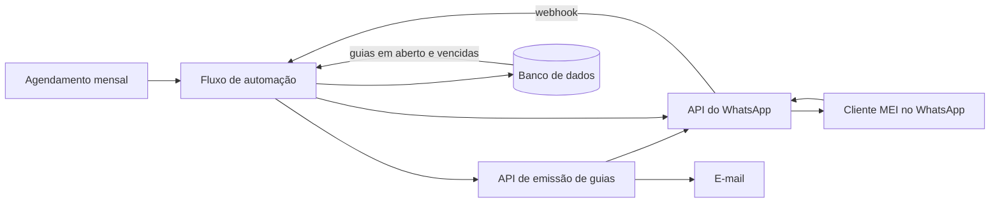

# ContMei

Contabilidade para MEI pelo WhatsApp: a guia mensal chega sozinha por e-mail e WhatsApp, e o empreendedor consulta guias em aberto ou vencidas na própria conversa.

## Problema

O MEI precisa pagar a guia mensal (DAS) em dia, mas costuma esquecer, perder o boleto ou não saber o que está pendente. Para quem atende vários MEIs, gerar e enviar cada guia e responder "tenho algo em atraso?" toma tempo todo mês.

## Solução

- **Guias mensais automáticas:** as guias das empresas MEI são geradas e enviadas por e-mail e WhatsApp, automaticamente ou quando o cliente pede.
- **Consulta de pendências:** o cliente pergunta no WhatsApp e recebe as guias em aberto e as vencidas para pagamento.
- **Atendimento por comandos:** menu com botões e comandos no WhatsApp, no canal que o MEI já usa.

## Como funciona

Detalhes em [docs/arquitetura.md](docs/arquitetura.md).

## Stack

- **Retool Workflows**: orquestração dos fluxos
- **Z-API**: integração com o WhatsApp (comandos e botões)
- **API de emissão de guias**: geração das guias mensais
- **E-mail**: envio das guias
- **Webhooks e APIs REST**

## Meu papel

Projetei e construí, para um escritório de contabilidade parceiro, os fluxos de geração, envio e consulta de guias e a integração com WhatsApp e e-mail.

## Status e resultados

- Construído e entregue a um escritório de contabilidade parceiro.

## O que aprendi

- **Uma boa solução precisa de uma dor que doa:** o MEI paga pouco por contabilidade, o próprio MEI e os bancos já geram as guias, e alguns bancos debitam automaticamente. Mesmo com custo mínimo, o mercado é pequeno para o contador investir.
- **Validar o mercado vem antes da construção:** a solução funcionava, mas quem pagaria por ela não sentia o problema com força suficiente.

## Contato

[guilhermesint.gerencia@gmail.com](mailto:guilhermesint.gerencia@gmail.com) · portfólio [guilhermevictaliano.github.io](https://guilhermevictaliano.github.io) · LinkedIn [linkedin.com/in/guilherme-victaliano-de-meira-b73933343](https://www.linkedin.com/in/guilherme-victaliano-de-meira-b73933343)

---

## English

**ContMei** brings accounting for Brazilian micro-entrepreneurs (MEI) to WhatsApp.
Each month's tax slip (DAS) is generated and sent by email and WhatsApp, either automatically or on request.
Clients use chat commands and buttons to ask which slips are open or overdue and get them back right away.
Built for a partner accounting firm with Retool Workflows, Z-API (WhatsApp), a tax-slip API and email. Flows are private; demo on request.
