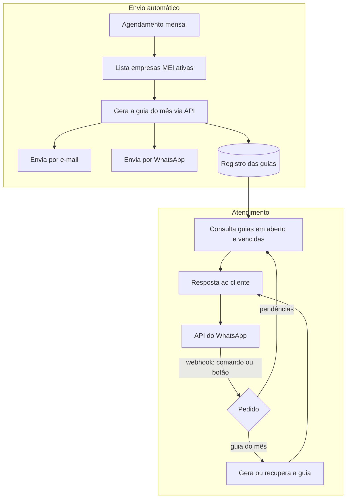

# Arquitetura: ContMei

## Visão geral

Dois gatilhos alimentam o mesmo fluxo no Retool: o agendamento mensal (envio automático) e a mensagem do cliente no WhatsApp (pedido de guia ou consulta de pendências).

## O que é regra e o que é IA

| Etapa | Tipo |
|---|---|
| Gerar e enviar a guia mensal | Regra (agendamento + API de emissão) |
| Identificar o pedido do cliente | Regra (comandos e botões no WhatsApp) |
| Consultar guias em aberto e vencidas | Regra (consulta ao registro) |

O ContMei é uma automação sem IA: o fluxo é previsível, e comandos e botões resolvem melhor que um modelo de linguagem.

## Decisões técnicas

- **Envio proativo e sob demanda no mesmo fluxo:** o cliente recebe a guia sem pedir, mas pode pedir de novo quando quiser.
- **WhatsApp e e-mail em paralelo:** o WhatsApp garante que a guia seja vista; o e-mail deixa um registro fácil de achar.
- **Retool Workflows:** agendamento, integrações e lógica num só lugar, sem servidor próprio.
